<!-- Header -->

  

  

  
  
  
  
  

---

### `> whoami`

I'm **Ebram Abdelmassih Shenoda**, known online as **KillByt3**, a junior **penetration tester & red team operator** from Egypt and a cybersecurity student at Beni-Suef National University.

  

### 🎖️ Certifications

  
  
  
  
  

### 🗡️ Kill chain I operate

| Phase | Technique | Tooling |
|---|---|---|
| Discovery | Domain enumeration, attack paths | BloodHound · Nmap |
| Credential Access | Password spraying, Kerberoasting | CrackMapExec · Rubeus · Hashcat |
| Lateral Movement | Pass-the-Hash | Impacket · CrackMapExec |
| Privilege Escalation | AD CS abuse | Certipy · Certify |
| Domain Dominance | DCSync | Mimikatz · secretsdump |

### 🧰 Arsenal

  

  
  
  
  
  
  
  
  
  
  
  
  

**Web:** OWASP Top 10 · SQLi · XSS · IDOR · auth bypass · subdomain enum  
**Blue side:** Splunk SIEM · log analysis · alert triage · threat detection

### 📝 Latest write-ups

- [Active Directory Trusts: How They Work and How Attackers Abuse Them](https://killbyt3-blog.vercel.app/posts/active-directory-trusts-how-they-work-and-how-attackers-abuse-them)
- [Attacking MSSQL Server](https://killbyt3-blog.vercel.app/posts/attacking-mssql-server)
- [Kitsune CTF (Active Directory, Easy, HackSmarter)](https://killbyt3-blog.vercel.app/posts/ctf)
- ➜ More on the [blog](https://killbyt3-blog.vercel.app/) and [Medium](https://medium.com/@0xZ3US)

### 🐍 Eating my contribution graph

<picture>
  <source media="(prefers-color-scheme: dark)" srcset="https://raw.githubusercontent.com/KillByt3/killbyt3/output/snake-dark.svg">
  <source media="(prefers-color-scheme: light)" srcset="https://raw.githubusercontent.com/KillByt3/killbyt3/output/snake-light.svg">
  
</picture>

  

